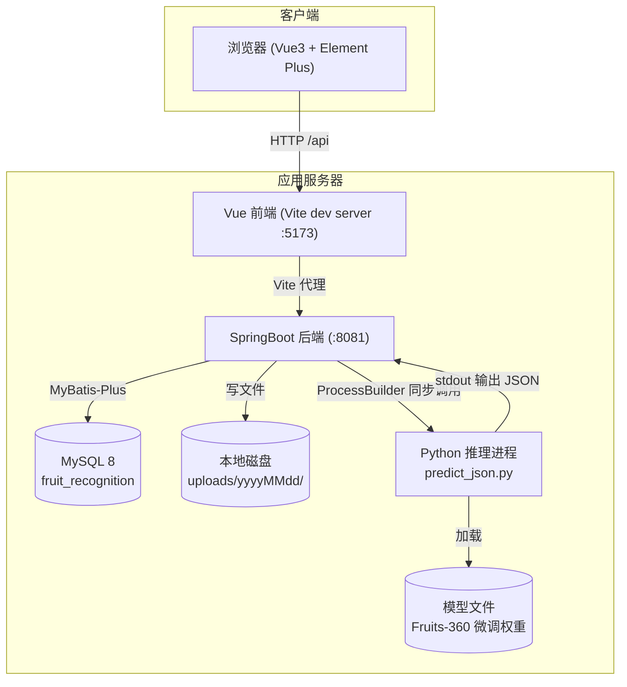
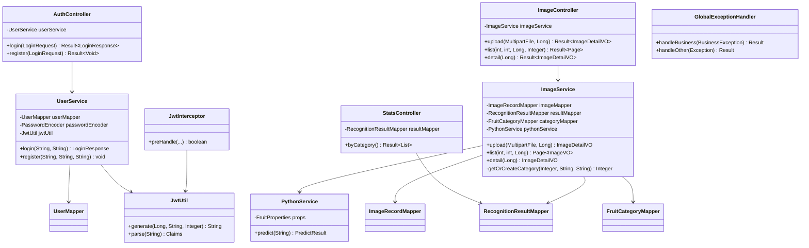
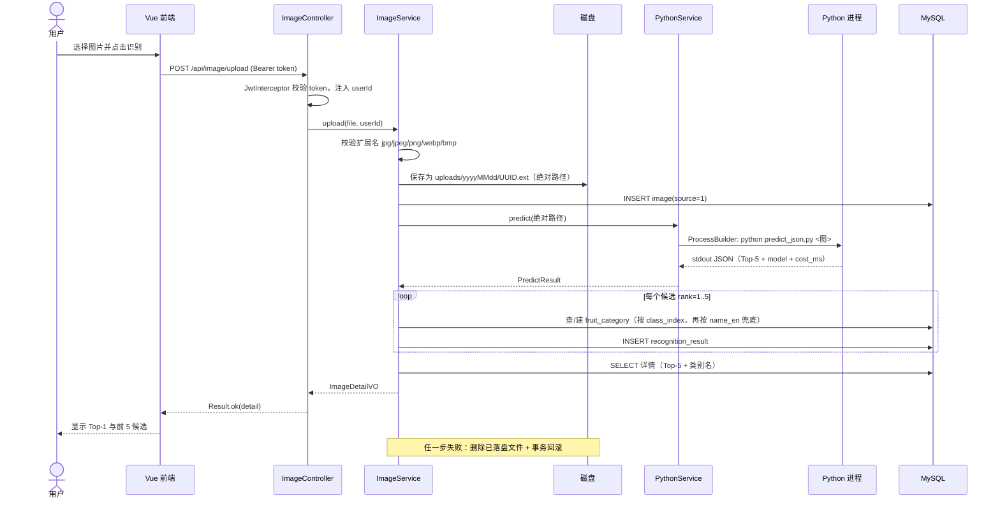
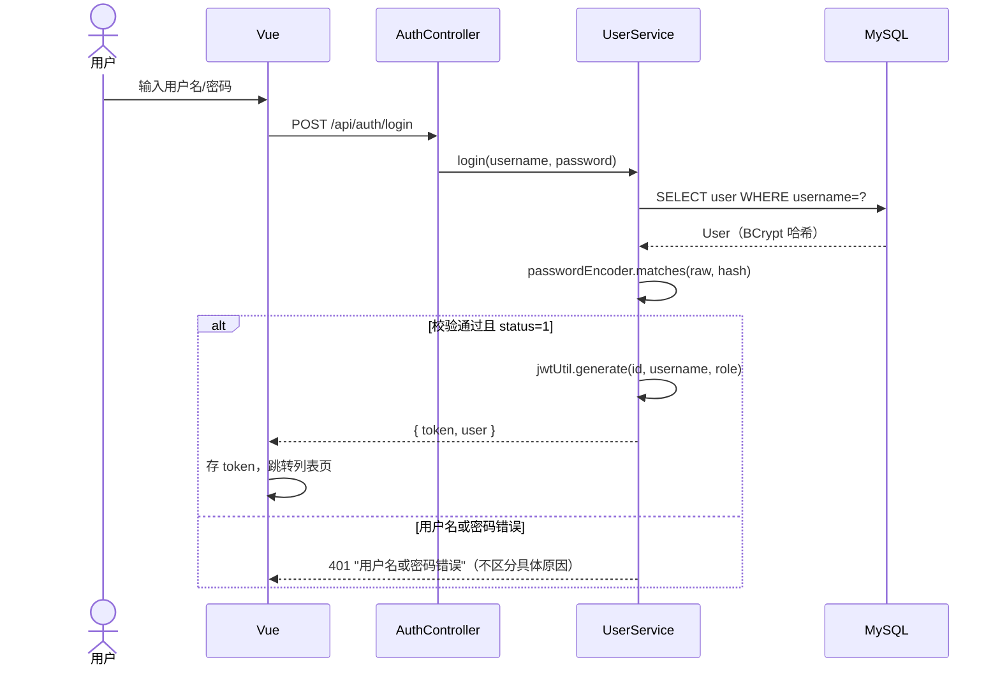
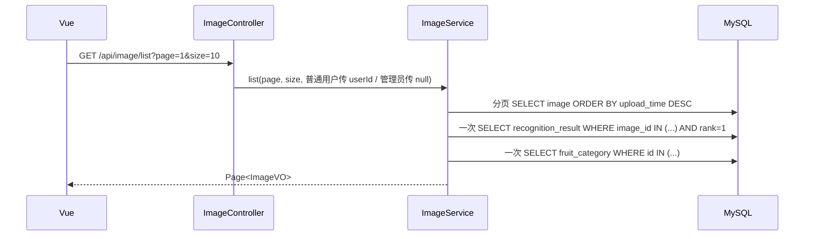
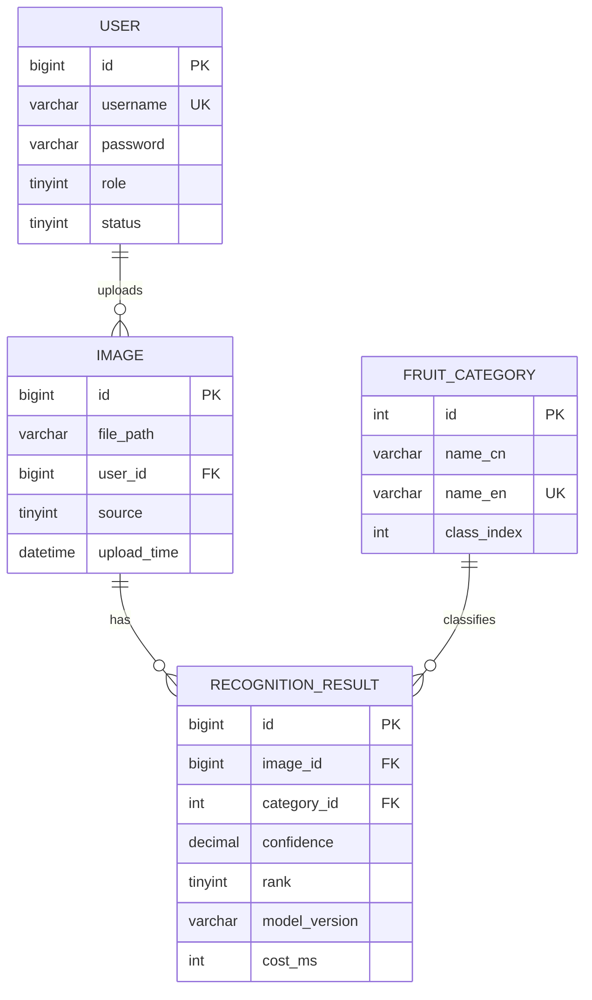

# 基于卷积神经网络的水果识别系统 · 系统设计文档 v0

> 配套文档：需求分析（`实训作业/1014-需求分析/`，含用例图/流程图/ER图）、数据库设计（`数据库设计-v0.md`）
> 版本：2026-10-19 · 状态：初稿（随代码同步修订）

---

## 1. 设计目标与约束

| 项 | 内容 |
|---|---|
| 系统名称 | 基于卷积神经网络的水果识别系统 |
| 用户角色 | 普通用户（上传/查看自己的记录）、管理员（查看全部记录与统计） |
| 核心用例 | 登录/注册、上传图片识别、识别历史列表、识别详情（Top-5）、分类统计 |
| 技术约束 | 本科毕设单机部署；无 GPU 服务器；演示需可离线运行 |
| 关键约束 | 模型推理必须用 Python（PyTorch），业务系统用 Java（SpringBoot），前端 Vue3 |

**为什么是三段式**：模型侧生态在 Python，工程侧（鉴权、CRUD、统计、部署）Java 更成熟；两者用「进程调用 + JSON」解耦，避免引入额外常驻服务。

---

## 2. 总体架构



**部署形态**：单机；前端 `npm run dev`（或打包后由静态服务器托管），后端 `java -jar`，Python 由后端按需拉起。

---

## 3. 模块划分

### 3.1 后端（`com.fruitrec`）

| 包 | 类 | 职责 |
|---|---|---|
| controller | `AuthController` | 登录、注册 |
| | `ImageController` | 上传识别、分页列表、详情 |
| | `StatsController` | 分类统计 |
| service | `UserService` | 用户查询、注册、密码校验、签发 JWT |
| | `ImageService` | 存盘、写记录、调用推理、结果入库、分页/详情组装 |
| | `PythonService` | 启动 Python 进程、读取 stdout、解析 JSON、超时控制 |
| dto | `LoginRequest/LoginResponse/UserVO` | 登录相关传输对象 |
| | `PredictResult` | Python 输出的映射（`success/results/model/cost_ms`） |
| | `ImageVO/ImageDetailVO/CategoryStatVO` | 前端展示对象 |
| entity | `User/ImageRecord/RecognitionResult/FruitCategory` | 四张表映射 |
| mapper | 四个 Mapper | MyBatis-Plus CRUD + 自定义统计 SQL |
| config | `WebConfig/MybatisPlusConfig/BeanConfig/FruitProperties` | 跨域、拦截器、分页插件、BCrypt、配置绑定 |
| interceptor | `JwtInterceptor` | 校验 `Authorization: Bearer`，把 userId/role 放入 request attribute |
| common | `Result/BusinessException/GlobalExceptionHandler` | 统一响应、业务异常、全局异常转换 |
| util | `JwtUtil` | JWT 生成与解析 |

### 3.2 前端（`fruit-web/src`）

| 文件 | 页面/职责 |
|---|---|
| `views/Login.vue` | 登录/注册 |
| `views/Layout.vue` | 侧边栏 + 路由出口 |
| `views/Upload.vue` | 选图 → 预览 → 上传 → 展示 Top-5 |
| `views/ImageList.vue` | 分页列表（缩略图 + 首位结果 + 置信度） |
| `views/ImageDetail.vue` | 大图 + 全部候选 + 模型版本/耗时 |
| `views/Stats.vue` | 分类识别数量图表 |
| `api/request.js` | axios 实例：注入 token、统一错误提示、401 跳登录 |
| `router/index.js` | 路由与登录守卫 |
| `store/user.js` | token / 用户信息 |

---

## 4. 核心类图



---

## 5. 关键时序

### 5.1 上传识别（同步链路）



### 5.2 登录鉴权



### 5.3 列表查询（规避 N+1）



---

## 6. 数据模型

ER 图见 `实训作业/1014-需求分析/uml/ER图_识别历史.png`；字段定义见 `数据库设计-v0.md`，建表脚本 `建表.sql`。



---

## 7. 接口设计

统一响应：`{ "code": 200, "message": "ok", "data": ... }`；鉴权头 `Authorization: Bearer <token>`。

| # | 方法 | 路径 | 入参 | 返回 | 鉴权 |
|---|---|---|---|---|---|
| 1 | POST | `/api/auth/login` | `{username, password}` | `{token, user}` | 否 |
| 2 | POST | `/api/auth/register` | `{username, password, nickname}` | `void` | 否 |
| 3 | POST | `/api/image/upload` | multipart `file` | `ImageDetailVO` | 是 |
| 4 | GET | `/api/image/list` | `page=1&size=10` | `Page<ImageVO>` | 是 |
| 5 | GET | `/api/image/{id}` | 路径 id | `ImageDetailVO` | 是 |
| 6 | GET | `/api/stats/category` | — | `[{name, count}]` | 是 |
| 7 | GET | `/uploads/**` | 静态资源 | 图片文件 | 否 |

**Python 契约**（stdout 单行 JSON）：

```json
{
  "success": true,
  "model": "mobilenet_v3_small-fruits360-v1",
  "cost_ms": 512,
  "results": [
    {"rank": 1, "class_index": 42, "name_en": "Apple Golden 1", "name_cn": "金冠苹果", "confidence": 0.9931},
    {"rank": 2, "class_index": 17, "name_en": "Apple Red 1", "name_cn": "红苹果", "confidence": 0.0042}
  ]
}
```

---

## 8. 关键设计决策与理由（答辩/论文素材）

| 决策 | 备选 | 选择理由 |
|---|---|---|
| Java 用 `ProcessBuilder` 调 Python（方案 D） | FastAPI 常驻服务 | 零新服务、零端口；代价是每次重载模型（约 5–8s）；以后提速只需改 `PythonService.execute` |
| 类别字典单独建表 `fruit_category` | 代码里写死 131 类 | 模型输出是数字索引，需要映射；新增类别只加数据不改代码 |
| 一张图存 5 行结果（rank 1–5） | 存一个 JSON 字段 | 规范化，便于按置信度查询与统计；答辩可讲一对多设计 |
| 列表页一次批量查结果与类别 | 每张图单独查（N+1） | 10 条记录从 21 次查询降到 3 次 |
| 上传同步返回 | 异步任务 + 轮询 | 演示链路简单直观；异步列入论文「展望」 |
| 用户不存在与密码错误返回同一提示 | 分别提示 | 防止用户名枚举 |
| 识别失败删除已落盘文件 | 保留垃圾文件 | 避免磁盘泄漏；数据库同步回滚 |
| 自动建类别（先 class_index，再 name_en 兜底） | 只按 class_index | 实测出现同名不同索引导致唯一键冲突；兜底逻辑是端到端测试发现的 |

---

## 9. 测试设计（TDD 用例）

| 编号 | 层次 | 用例 | 预期 |
|---|---|---|---|
| T01 | 单元 | `UserService.login` 正确密码 | 返回 token 与用户信息 |
| T02 | 单元 | `UserService.login` 密码错误 | 抛 `BusinessException`，code=401 |
| T03 | 单元 | `UserService.login` 账号禁用 | 抛 `BusinessException`，code=403 |
| T04 | 单元 | `UserService.register` 用户名已存在 | 抛 `BusinessException`，code=400 |
| T05 | 单元 | `JwtUtil` 生成→解析 | userId/username/role 一致 |
| T06 | 单元 | `ImageService.upload` 非法扩展名 | 抛异常，且不写库 |
| T07 | 单元 | `ImageService.detail` 不存在 id | 抛 404 业务异常 |
| T08 | 集成 | 登录 → 上传 → 列表 → 详情 → 统计 | 全链路 200（已手工实测，待脚本化） |

> 实现位置：`fruit-server/src/test/java/com/fruitrec/`；运行 `mvn test`。

---

## 10. 非功能设计

- **性能**：单图识别约 5–8s（含 Python 冷启动）；列表接口一次批量查询；分页上限 100。
- **安全**：密码 BCrypt；JWT 过期控制；上传扩展名白名单；403/401 统一处理；上传目录与静态资源隔离。
- **可靠性**：识别失败清理文件 + 事务回滚；Python 超时可配置（默认 60s）；同时排空 stdout/stderr 防止缓冲区死锁。
- **可维护性**：上传路径、Python 解释器/脚本、超时全部走 `application.yml`（`fruit.*`），换机器只改配置。
- **可扩展**：换模型只替换权重与 `class_index` 映射；异步识别可替换 `PythonService`；多模型版本可加 `model_info` 表。

---

## 11. 后续演进（论文「展望」）

1. 异步识别队列（上传即返回，轮询结果），解决 5–8s 等待。
2. FastAPI 常驻推理服务 + 批处理，消除冷启动。
3. 模型版本管理与 A/B 对比（`model_info` 表）。
4. 识别失败样本回流，形成增量训练闭环。
